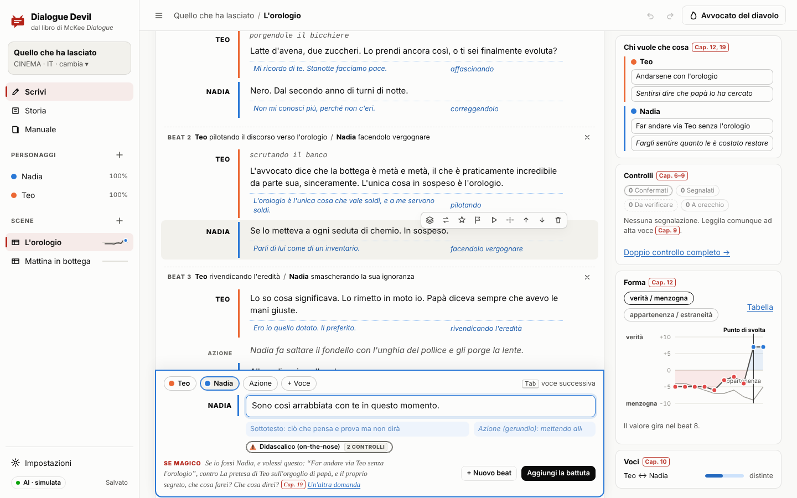
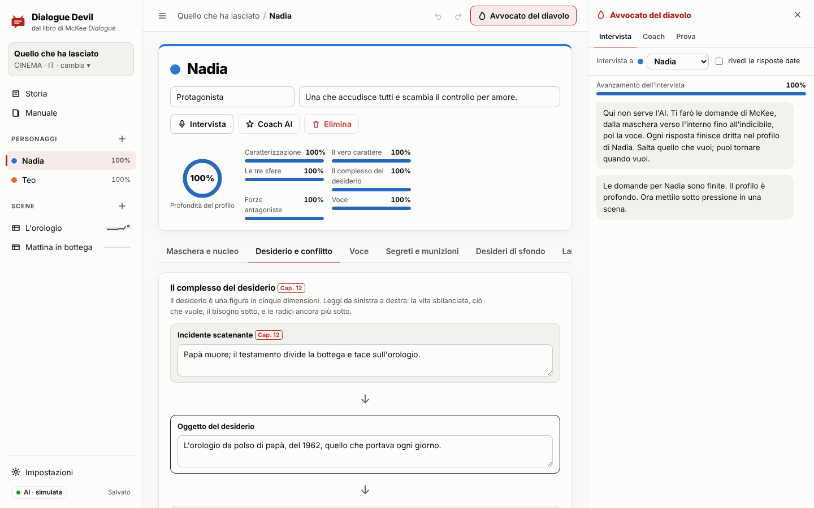
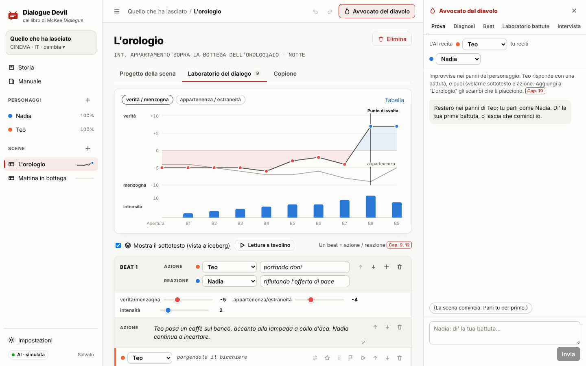
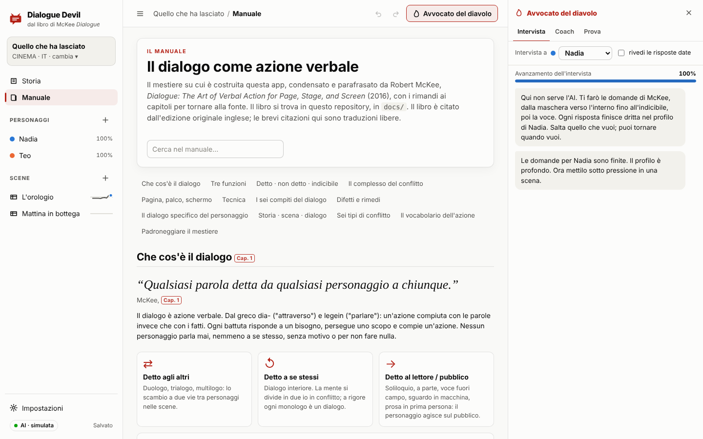
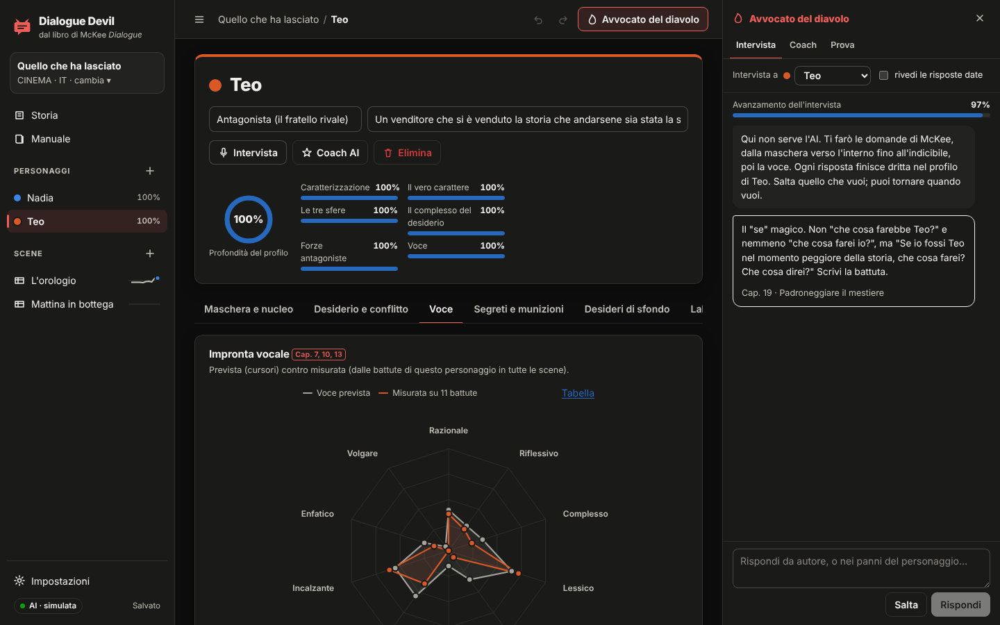
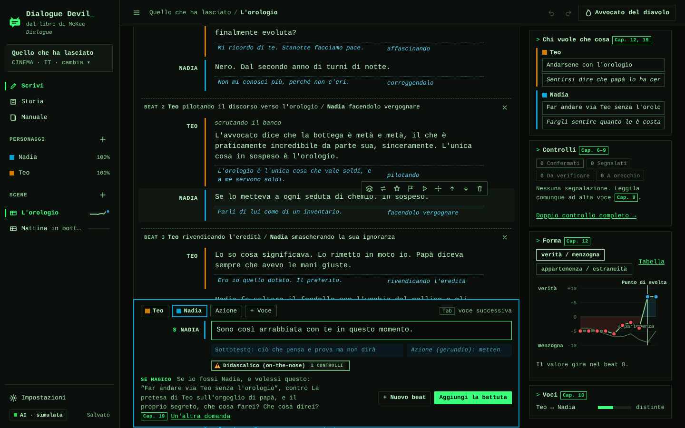

# Dialogue Devil

*Read in English: [README.md](README.md).*

Un banco di lavoro interattivo e visivo per costruire personaggi di finzione e sviluppare i loro dialoghi, fondato su *Dialogue: The Art of Verbal Action for Page, Stage, and Screen* di Robert McKee (2016). Il libro è in [`docs/`](docs/).

Il punto di partenza di McKee è che il dialogo è azione verbale. Ogni battuta è una tattica con cui il personaggio cerca di ottenere ciò che vuole, e le parole poggiano su un sottotesto di desiderio, antagonismo e scelta. Dialogue Devil trasforma quel metodo in un lavoro pratico. Costruisci i personaggi dall'interno verso l'esterno e progetti le scene beat per beat. Ogni battuta si scrive sopra il suo sottotesto, e mentre scrivi la scena viene confrontata con i difetti e i rimedi del libro. Un "Avvocato del diavolo" facoltativo, basato su Claude, può intervistarti, improvvisare nei panni di un personaggio e proporre revisioni.

Il pannello principale è il **tavolo di scrittura**, dove si abbozzano i dialoghi in fretta, a una voce o a più voci. Si legge come una pagina di copione e prende le battute alla velocità con cui le scrivi. Gli strumenti di McKee aspettano a margine, sotto la battuta e in un pannello laterale, invece di stare su ogni battuta.

L'intera applicazione funziona in italiano: interfaccia, manuale, regole di analisi, progetto d'esempio, collaboratore AI, esportazioni, messaggi del server e console.



## Avvio rapido

Serve Node.js 20 o successivo.

```bash
npm install
npm start
```

Apri **http://localhost:4134**: si apre sul tavolo di scrittura. L'interfaccia segue la lingua del browser (italiano o inglese); puoi cambiarla in **Impostazioni → Lingua**. Al primo avvio viene creato un progetto d'esempio originale, *Quello che ha lasciato* (o *What He Left* se il server è in inglese), così ogni vista ha qualcosa da mostrare. Per avere la console e il primo esempio in italiano:

```bash
DD_LANG=it npm start
```

Il server è raggiungibile anche dalla rete locale. All'avvio stampa l'indirizzo da aprire su un telefono, un tablet o un altro computer della stessa rete Wi-Fi:

```
Dialogue Devil è in funzione.
  Questo computer:  http://localhost:4134
  La tua rete:   http://192.168.1.23:4134   (telefoni, tablet, altri computer di questa rete Wi-Fi/LAN)
  Possono collegarsi solo i dispositivi della tua rete locale.
  Codice d'accesso: disattivato. Imposta DD_ACCESS_CODE=… per richiederlo sugli altri dispositivi.
```

| Variabile | Predefinito | A cosa serve |
|---|---|---|
| `PORT` | `4134` | Porta HTTP |
| `HOST` | `0.0.0.0` | Indirizzo di ascolto. `0.0.0.0` apre l'app alla tua rete; `127.0.0.1` la tiene su questo computer. |
| `DD_ACCESS_CODE` | (non impostato) | Codice che gli altri dispositivi devono inserire una volta (ricordato per 30 giorni). Questo computer non ne ha mai bisogno. |
| `DD_ALLOW_PUBLIC` | (non impostato) | `1` lascia collegare indirizzi non privati (internet). Disattivato per impostazione predefinita; leggi sotto prima di attivarlo. |
| `DD_DATA_DIR` | `./data/projects` | Dove vengono salvati i progetti (un file JSON ciascuno) |
| `ANTHROPIC_API_KEY` | (non impostato) | Attiva il collaboratore AI per chiunque usi questo server |
| `DD_MODEL` | `claude-opus-5-5` | Modello Claude predefinito |
| `DD_AI_MOCK` | (non impostato) | `1` = risposte AI simulate, per lavorare offline e fare dimostrazioni |
| `DD_LANG` | da `LANG` | `it` o `en`: lingua della console e del progetto d'esempio creato al primo avvio. L'app segue la lingua di ciascun browser. |

## Usarlo da altri dispositivi

1. Avvia il server su un computer (`npm start`, oppure `DD_ACCESS_CODE=scegli-un-codice npm start`).
2. Sull'altro dispositivo apri l'indirizzo **La tua rete**. **Impostazioni → Altri dispositivi** mostra gli stessi indirizzi con il pulsante per copiarli.
3. Se non si carica, consenti Node.js o la porta 4134 nel firewall di quel computer. I due dispositivi devono stare sulla stessa rete: una rete Wi-Fi ospiti che isola i client lo impedisce.

Tutti i dispositivi lavorano sugli stessi progetti:
- **Aggiornamenti dal vivo.** Un dispositivo inattivo riceve le modifiche salvate altrove entro circa quattro secondi.
- **Nessuna sovrascrittura silenziosa.** Ogni salvataggio porta con sé la versione da cui è partito. Se un altro dispositivo ha salvato prima, il server rifiuta il salvataggio superato (HTTP 409) e l'app chiede cosa tenere: *Carica la più recente*, *Salva la mia come copia* o *Tieni la mia* (dopo una conferma).
- **Niente si perde chiudendo o perdendo la connessione.** Le modifiche vengono copiate nel browser mentre scrivi e inviate quando la scheda viene nascosta o chiusa. Se il server non è raggiungibile restano in locale e vengono ripristinate alla prossima apertura del progetto.

Sicurezza predefinita:
- Possono collegarsi solo i dispositivi della rete locale: indirizzi privati (10.x, 172.16–31.x, 192.168.x e reti VPN come quella di Tailscale, 100.64/10), più i dispositivi della sottorete di questo computer, per le reti che usano internamente indirizzi pubblici. Il controllo usa l'indirizzo reale della connessione; `X-Forwarded-For` viene ignorato.
- Senza `DD_ACCESS_CODE` chiunque sia sulla tua rete può aprire i tuoi progetti, e usare la `ANTHROPIC_API_KEY` del server se è impostata. Sulle reti condivise imposta un codice d'accesso. Il server lo ricorda all'avvio quando trova una chiave senza codice.
- Una chiave API inserita nelle Impostazioni resta in quel solo browser. Ogni dispositivo che deve usare l'AI ha bisogno della sua chiave, oppure imposta `ANTHROPIC_API_KEY` sul server.
- `DD_ALLOW_PUBLIC=1` espone l'app a chiunque raggiunga la porta, e il traffico è HTTP in chiaro. Se ti serve l'accesso da fuori, usa piuttosto una VPN come Tailscale, oppure metti l'app dietro un reverse proxy HTTPS *e* imposta un codice d'accesso.

## La versione italiana

- **Due impostazioni di lingua** in *Impostazioni → Lingua*:
  - la **lingua dell'interfaccia**: menu, manuale, messaggi dell'analizzatore e risposte dell'AI. È salvata per browser, e alla prima visita segue la lingua del browser;
  - la **lingua dei dialoghi** del progetto, salvata con il progetto. Decide quali regole leggono le battute, quali voci usa la lettura a tavolino, la lingua delle esportazioni e quella in cui l'AI scrive le battute.

  Sono indipendenti: si può usare l'interfaccia inglese su un copione italiano, e viceversa. Un nuovo progetto parte nella lingua dell'interfaccia.
- **Base di conoscenza italiana** (`public/js/kb/it.js`): ogni principio, difetto, domanda dell'intervista, esercizio e tattica, con gli stessi identificativi e gli stessi rimandi ai capitoli (`Cap. n`) della versione inglese. Le citazioni sono traduzioni libere dal testo inglese, non l'edizione italiana pubblicata.
- **Regole di analisi italiane** (`public/js/lang/it.js`): gli stessi controlli, riscritti per l'italiano invece che tradotti.
  - Le tattiche sono gerundi italiani (*-ando/-endo*, anche con i pronomi: *mettendola alla prova*).
  - Quasi tutto l'italiano viene dal latino, quindi il controllo inglese sul lessico latineggiante diventa un controllo sull'**italiano astratto e burocratico** (*burocratese*: *problematica*, *procedere*, lunghi nomi in *-zione/-mento*).
  - La divisione in parole separa le elisioni (*l'ho*, *dell'eredità*), le sillabe si contano per gruppi vocalici con lo iato, il passivo è *essere/venire/andare* + participio.
  - Lessici italiani per i cliché (*al punto di partenza*, *prendere il toro per le corna*…), per le battute didascaliche e l'esposizione forzata (*Come sai…*, *Ti ricordi quando…*), per emozioni, riempitivi e modalità. Le norme della voce sono tarate sull'italiano.
  - Il secondo lettore riduce i verbi italiani alla radice e toglie i pronomi enclitici (*spiegarti*, *spiegando*, *spiegato* → *spieg*).
- **Esempio italiano**, *Quello che ha lasciato*: gli stessi personaggi, scene e beat, scritti in italiano e non tradotti parola per parola, con gli stessi risultati di analisi dell'esempio inglese.
- **AI in italiano**: Claude riceve il quadro teorico in italiano, risponde nella lingua dell'interfaccia e scrive battute, sottotesto e tattiche (al gerundio) nella lingua del progetto.
- **Esportazioni**: la bozza in prosa usa le «caporali» e *disse/chiese*; lo schema annotato usa AZIONE/REAZIONE; il formato Fountain conserva le parole chiave obbligatorie (`Title:`).
- **Lettura a tavolino** con una voce di sistema italiana per i dialoghi italiani (se non c'è, scorre in silenzio).
- **Server**: gli errori delle API tornano nella lingua dell'interfaccia; `DD_LANG=it` (o un `LANG` italiano) imposta la console e il primo esempio.

## Che cosa contiene

Ogni principio dell'app è parafrasato dal libro e marcato con il capitolo da cui proviene (i badge rossi `Cap. n`; passa sopra con il mouse per il titolo del capitolo).

### Tavolo di scrittura (il pannello principale)
Qui si abbozzano i dialoghi, a una voce o a più voci. Ogni dialogo è una scena, quindi tutto ciò che scrivi qui alimenta anche il progetto della scena, il laboratorio dei beat, i controlli e le esportazioni.

- **Una pagina di copione.** Ogni battuta mostra chi parla, l'eventuale didascalia tra parentesi e le parole. Fai clic su una battuta per modificarla sul posto. I suoi strumenti compaiono solo sulla battuta su cui sei: sottotesto, alternative, laboratorio battute AI, segnalazione, lettura da qui, nuovo beat da qui, sposta, elimina.
- **Un compositore ancorato in fondo alla pagina.** Scegli chi parla, scrivi, premi <kbd>Invio</kbd>. Il turno passa da solo alla voce successiva: in un duologo all'altra, in un gruppo a chi aveva parlato prima.
- **Chi c'è.** Un nuovo dialogo parte senza personaggi. Scegli quelli del progetto, o scrivi un nome nuovo e diventa un personaggio. **Si parla a:** imposta le tre direzioni di McKee (agli altri, a se stessi, al pubblico), così una sola voce può essere dialogo interiore o soliloquio (Cap. 1).
- **Scrittura rapida** nel compositore:

  | Scrivi | Ottieni |
  |---|---|
  | `NOME: battuta` | la battuta, detta da NOME; un nome nuovo in maiuscolo crea il personaggio |
  | `(sottovoce) battuta` | il paralinguaggio, al suo posto |
  | `[Se ne va.]` | un'azione: didascalia, gesto, silenzio |
  | `---` | un cambio di beat |

- **Incolla una scena intera** (una trascrizione `NOME: battuta`, o una sceneggiatura in stile Fountain): entra battuta per battuta, e i personaggi nuovi vengono creati una volta sola.
- **I beat come stacchi.** Una riga sottile tra un beat e l'altro ne indica l'azione e la reazione (prese dalle tattiche delle battute). Aprila per impostare la carica del valore principale e l'intensità, o per togliere lo stacco.
- **Controlli a margine.** Un piccolo segno dice quante note ha una battuta; aprilo per vedere i rilievi del doppio controllo. Togliendo la spunta a **Controlli a margine** li nascondi mentre abbozzi. La bozza nel compositore viene controllata mentre scrivi.
- **Sottotesto su richiesta.** Con **Sottotesto** attivo, il sottotesto e l'azione (al gerundio) di ogni battuta stanno appena sotto. Quelli vuoti compaiono solo sulla battuta che stai modificando.
- **La lente di McKee** (pannello laterale): che cosa vuole ogni voce adesso e che cosa vuole davvero; i controlli, con il salto a ogni battuta segnalata; l'arco del valore e il suo punto di svolta; quanto si distinguono le voci; le modalità dell'Avvocato del diavolo (prova, beat suggeriti, diagnosi) e *copia come sceneggiatura*.
- Sotto il compositore, una domanda a rotazione pone il "se" magico e i cinque passi per chi sta parlando (Cap. 12, 19).

| Tasti | Nel compositore | Su una battuta |
|---|---|---|
| <kbd>Invio</kbd> | aggiunge la battuta | apre una nuova battuta dopo |
| <kbd>Maiusc</kbd>+<kbd>Invio</kbd> | a capo nel testo | a capo nel testo |
| <kbd>Tab</kbd> / <kbd>Maiusc</kbd>+<kbd>Tab</kbd> | voce successiva / precedente | |
| <kbd>Alt</kbd>+<kbd>1</kbd>…<kbd>9</kbd>, <kbd>Alt</kbd>+<kbd>0</kbd> | sceglie una voce, o un'azione | |
| <kbd>Ctrl</kbd>+<kbd>Invio</kbd> | aggiunge la battuta come nuovo beat | |
| <kbd>↑</kbd> (riquadro vuoto) | modifica l'ultima battuta | |
| <kbd>Alt</kbd>+<kbd>↑</kbd> / <kbd>↓</kbd> | | sposta la battuta (anche oltre gli stacchi di beat) |
| <kbd>Backspace</kbd> (battuta vuota) | | elimina la battuta |
| <kbd>Esc</kbd> | esce dal riquadro (poi <kbd>Tab</kbd> va avanti) | esce dalla battuta |

L'apparato completo è a un clic: **Progetto della scena**, **Laboratorio dei beat** e **Copione**.

### Cruscotto della storia
Mezzo (teatro/cinema/televisione/narrativa) e visione (realismo o non realismo, che cambia quanto severamente si giudica il dialogo didascalico, Cap. 8). Poi il valore centrale, l'incidente scatenante e la domanda drammatica principale. Infografiche:
- **Schede del cast** con mini impronte vocali e profondità del profilo.
- **Confronto delle voci**: sovrappone fino a tre voci e misura quanto sono distanti (Cap. 10).
- **Mappa del complesso di conflitti**: personaggi × antagonismo fisico/sociale/personale/interiore, con il verdetto "complesso o complicato" (Cap. 4, 12).
- **Tabella delle scene** con l'arco del valore in miniatura, i punti di svolta e la salute dei sei compiti.

### Studio del personaggio (tutti gli elementi del personaggio presenti nel libro)
| Scheda | Elementi | Fonte |
|---|---|---|
| Maschera e nucleo | Le **tre sfere** interattive (detto / non detto / indicibile). Caratterizzazione (biologia, educazione, istruzione, mentalità, valori) contro vero carattere, la contraddizione di fondo, mentalità drammatica o comica e l'"umore" comico | Prefazione, Cap. 2, 3, 14 |
| Desiderio e conflitto | Mappa del **complesso del desiderio**: incidente scatenante → oggetto del desiderio → spina dell'azione, super-obiettivo contro desiderio inconscio, motivazione contro scusa. Le **forze antagoniste** come quattro anelli concentrici | Cap. 6, 12, 4 |
| Voce | **Radar dell'impronta vocale**, prevista (cursori) contro misurata sulle battute reali del personaggio in tutte le scene. Dieci dimensioni della voce più il livello di contesto; lessico (nomi e verbi del suo sapere, modificatori, parole tipiche, parole che non direbbe mai, scrigno culturale); modalità; struttura naturale della battuta; dialetto e paralinguaggio | Cap. 5, 7, 10, 12, 13 |
| Segreti e munizioni | I segreti con il loro dilemma del male minore e la scena in cui vengono rivelati. I fatti espositivi ordinati per importanza, da mandare in scena come munizioni | Cap. 2 |
| Desideri di sfondo | La **rete dei vincoli**: relazioni con una carica che diverge, e ciò che il personaggio non può ancora dire | Cap. 12 |
| Laboratorio della voce | Esercizi "dillo a modo suo" (lo shock senza "Oh mio Dio", l'amore non detto, dire o attenuare, il tropo sensoriale, il verbo specifico, la terza cosa, il "se" magico…), ciascuno analizzato dal vivo. Un riquadro per mettere alla prova qualsiasi battuta | Cap. 2, 5–8, 10, 15, 19 |



### Progetto della scena
Direzione (verso gli altri / verso sé / verso il pubblico) e modo (drammatizzato/narrato). Uno dei sei **tipi di conflitto** dei casi di studio (bilanciato, comico, asimmetrico, indiretto, riflessivo, minimo), ciascuno con i suoi consigli. **Chi vuole che cosa**: intenzioni consce e inconsce nella scena, tattiche d'apertura, percezione dell'antagonismo e chi guida la scena. **Valori in gioco** con le cariche d'apertura. Il diagramma della **terza cosa** (trialogo contro duelogo). L'esposizione da far passare, il piano del punto di svolta e la lista delle **domande chiave** del Cap. 19.

### Laboratorio dei beat (l'apparato completo)
La stessa scena del tavolo di scrittura, con tutti gli strumenti in vista.



- **Arco del valore**: la carica beat per beat di ogni valore in gioco, con il punto di svolta trovato automaticamente e le barre d'intensità sotto. Passa sopra per la lettura puntuale, o passa alla vista a tabella.
- **Beat** nominati come coppie azione/reazione al gerundio (per esempio *Teo portando doni / Nadia rifiutando l'offerta di pace*), ciascuno con le sue cariche e la sua intensità.
- **Battute in vista a iceberg**: il detto sopra la linea di galleggiamento, il non detto e l'azione (al gerundio) sotto. Paralinguaggio, didascalie e silenzi sono elementi a pieno titolo.
- **Compositore costruito sui cinque passi del comportamento**: desiderio → percezione dell'antagonismo → scelta dell'azione → azione → espressione, con un invito dal vivo al **"se" magico**. Le tattiche delle battute riempiono da sole l'azione e la reazione del beat.
- **Taccuino delle alternative** su ogni battuta, dal "non accontentarti mai della prima scelta" del Cap. 7: scambia le versioni quando vuoi.
- **Analisi dal vivo** di ogni battuta e dell'intera scena:
  - battute didascaliche, chiacchiere vuote ed esposizione forzata;
  - emotività e perspicacia eccessive, melodramma (emozione sproporzionata rispetto alla posta del beat);
  - cliché e frasi neutre che potrebbe dire chiunque; zavorra; italiano astratto e burocratico; passivo; discorsi lunghi e la fallacia del monologo;
  - significato confuso, battute mal temporizzate, echi involontari e parole che il personaggio "non direbbe mai";
  - a livello di scena: beat ripetitivi, non-eventi e punti di svolta fuori tempo, dueloghi, personaggi che parlano allo stesso modo e voci che si allontanano dal profilo.
- **Doppio controllo** (sotto): controlli indipendenti che colgono ciò che un solo passaggio lascia sfuggire.
- **Lettura a tavolino**: il browser legge la scena ad alta voce battuta per battuta, e premi <kbd>F</kbd> per segnare una battuta che suona male. I casi di studio consigliano di leggere le scene ad alta voce, o meglio ancora di recitarle (Cap. 13, 15). Dove la sintesi vocale non c'è, scorre in silenzio al ritmo di lettura.
- **Pagella dei sei compiti del dialogo**, più una tabella **contenuto · lunghezza · ritmo** per chi parla, sul modello dei Soprano (Cap. 13).
- **Copione** esportabile: sceneggiatura Fountain, testo teatrale, bozza in prosa, o schema annotato dei beat con il sottotesto.

### Doppio controllo: limitare ciò che sfugge
Un solo insieme di regole è preciso ma lascia sfuggire molto. Così ogni battuta passa per controlli indipendenti, e i risultati vengono uniti:

| Livello | Che cosa fa | Richiede |
|---|---|---|
| **Regole** | Schemi precisi: affermazioni didascaliche, cliché, zavorra, lessico burocratico, discorsi lunghi… | niente |
| **Secondo lettore** | Un passaggio pensato per non perdere nulla. Riduce le parole alla radice, riconosce le frasi fatte anche con parole in mezzo e usa lessici di emozioni, esposizione e astrazione. A livello di scena cerca anche tattiche ripetute e reazioni mancanti. | niente |
| **Revisione AI** | Claude legge la scena con i profili e i risultati dell'analizzatore. Segnala ciò che gli altri controlli hanno perso e contesta i loro falsi allarmi. | chiave API |
| **Il tuo orecchio** | Le battute che segni durante la lettura a tavolino | niente |

Ogni rilievo mostra le sue fonti e uno stato:
- **Confermato**: due o più controlli concordano.
- **Segnalato**: solo le regole.
- **Da verificare**: un solo controllo sensibile, quindi guarda prima di intervenire.
- **A orecchio**: l'hai segnato tu.

L'AI può segnare un rilievo come *contestato*, con la sua ragione. Puoi **ignorare** un rilievo come voluto: viene ricordato battuta per battuta e si può rimostrare. I risultati dell'AI hanno un'impronta per battuta: se modifichi una battuta, i suoi rilievi AI risultano superati fino alla revisione successiva. La scheda del doppio controllo mostra la copertura di ogni livello, e la tabella della storia conta le battute ancora da verificare.

Misurato sul corpus italiano `test/fixtures/flawed-lines.it.js` (battute originali scritte apposta, quindi i numeri sono ottimisti):

| Serie | Solo regole | Regole + secondo lettore |
|---|---|---|
| Serie di taratura, 43 battute difettose | 56% | 100% |
| Prima serie di verifica, 24 battute, misurata una volta prima di ogni correzione | 38% | 75% |
| Seconda serie di verifica, 20 battute scritte dopo la taratura e mai usate per tarare | 60% | 80% |
| Battute pulite segnalate per errore | 0 / 12 | 0 / 12 |

La prima serie di verifica è poi servita a correggere lacune generali, quindi non conta più come misura indipendente (ora arriva al 100%). La seconda è il dato onesto. Su battute mai viste i controlli italiani perdono circa un difetto su cinque, più di quelli inglesi (che sulle loro battute di verifica passano dal 38% al 100%). Per questo in italiano la revisione AI e la lettura a tavolino contano ancora di più. I rilievi "da verificare" non sono errori: sono inviti a guardare di nuovo.

### Manuale
Una sintesi del quadro teorico del libro, consultabile e illustrata con infografiche. Comprende:
- la definizione, le tre direzioni e le tre funzioni del dialogo;
- le sfere, il complesso di conflitti e il dialogo nei diversi mezzi;
- la struttura della battuta, la tecnica e i sei compiti;
- ogni difetto con il suo rimedio;
- il dialogo specifico del personaggio, e il progetto di storia e scena (complesso del desiderio, cinque passi, beat, punti di svolta);
- i sei tipi di conflitto, un vocabolario delle tattiche, le domande chiave e gli assiomi.



### L'Avvocato del diavolo (pannello a destra)
- **Intervista** (senza AI): un intervistatore dialogico che pone le domande di McKee dalla maschera verso l'indicibile, poi sulla voce. Ogni risposta finisce dritta nel profilo.
- **Modalità AI** (facoltative), ciascuna richiede una chiave API:
  - **Coach**: ti intervista su un personaggio e propone aggiornamenti al profilo come schede da applicare o scartare.
  - **Prova**: l'AI improvvisa *nei panni del personaggio*, con il suo profilo vocale e l'intenzione della scena, mentre tu reciti l'altra parte. Ogni risposta porta con sé sottotesto e azione nascosti, e puoi aggiungere alla scena qualsiasi scambio.
  - **Diagnosi**: diagnostica la scena a partire dai rilievi dell'analizzatore, prima le cause profonde, e propone riscritture.
  - **Beat**: propone i beat successivi, ognuno più forte del precedente.
  - **Laboratorio battute**: cinque alternative per una battuta, ciascuna con una tattica diversa.
  - **Revisione**: il livello AI del doppio controllo (si avvia dalla scheda del doppio controllo nel laboratorio).

L'AI non modifica mai direttamente il tuo lavoro. Chiama strumenti di proposta, e sei tu a scegliere cosa applicare. Ogni modifica applicata dall'AI si può annullare.



### Temi
In **Impostazioni → Aspetto → Tema**, *Sistema* segue il dispositivo (chiaro o scuro), oppure puoi scegliere *Chiaro*, *Scuro* o *Terminale*.

**Terminale** è un tema minimale in stile fosfori verdi: un solo carattere monospaziato, verde su nero, angoli vivi, niente ombre, pulsanti e selezione in negativo. Gli otto colori dei personaggi e le palette dei grafici sono stati verificati sullo sfondo del terminale per luminosità, distinguibilità con i deficit della visione dei colori e contrasto, così personaggi e grafici restano facili da distinguere. Tutto il testo supera il contrasto 4,5:1.



## Configurare l'AI (facoltativo)

Avvia il server con `ANTHROPIC_API_KEY` impostata, oppure incolla una chiave nelle **Impostazioni**. Una chiave inserita nelle Impostazioni resta nella memoria locale di quel browser e viene inviata al tuo server Dialogue Devil a ogni richiesta AI; il server la usa solo per quella richiesta e non la scrive mai su disco.

Dietro le quinte, `server/ai.js` usa l'SDK ufficiale `@anthropic-ai/sdk`:
- un ciclo di tool use in streaming sulla Messages API, con il testo inviato al browser tramite server-sent events;
- strumenti di proposta validati con zod prima di arrivare all'interfaccia;
- streaming anticipato degli input degli strumenti;
- un blocco di sistema in cache generato dalla stessa base di conoscenza usata dall'interfaccia (`public/js/kb/`), nella lingua di chi scrive;
- il fallback lato server in caso di rifiuto (`fallbacks: "default"`) sui modelli che lo supportano.

Il modello predefinito è Claude Opus 5.5; le Impostazioni offrono anche Sonnet 5.5, Haiku 5.5 e Fable 5.1.

## Struttura del progetto

```
server.js               App Express: interfaccia statica, API REST dei progetti, endpoint AI in SSE (porta 4134)
server/ai.js            Ciclo dell'agente Claude, validazione degli strumenti, errori, modalità simulata
server/prompts.js       Prompt di sistema (costruito dalla base di conoscenza) e definizione degli strumenti
server/storage.js       Archivio su file JSON, uno per progetto, con revisioni e blocchi di salvataggio per progetto
server/network.js       Filtro LAN (solo indirizzi privati), codice d'accesso facoltativo, indirizzi di rete
server/lang.js          Lingua di ogni richiesta (x-dd-lang, Accept-Language) e della console (DD_LANG, LANG)
public/index.html       Guscio dell'app a pagina singola (Preact + htm, senza build)
public/css/app.css      Token di design (chiaro/scuro), impaginazione, componenti
public/js/kb/en.js, it.js  La base di conoscenza in ogni lingua: principi, schema, intervista, tattiche, difetti, con i capitoli
public/js/mckee.js      Fornisce la base di conoscenza nella lingua dell'interfaccia
public/js/i18n.js       Lingua dell'interfaccia: tr()/trl()/trn(), formati di data, riconoscimento della lingua
public/js/locales/it.js Dizionario italiano (testo inglese di partenza → italiano)
public/js/lang/en.js, it.js  Pacchetti di analisi per lingua: parole, sillabe, lessici, schemi, norme, radici
public/js/analysis.js   Motore di analisi del dialogo: il livello delle regole (funzioni pure, condivise con i test)
public/js/secondreader.js  Secondo lettore: il livello pensato per non perdere nulla
public/js/doublecheck.js   Unisce regole, secondo lettore, revisione AI e segnalazioni di chi scrive in un unico stato
public/js/review.js     Avvia la revisione AI e la salva con le impronte delle battute
public/js/store.js      Stato, salvataggio automatico con revisioni, conflitti, copie locali, aggiornamenti dal vivo
public/js/model.js      Modello dei dati e costruttori
public/js/sample.js     Progetto d'esempio originale ("What He Left")
public/js/sample.it.js  La sua versione italiana ("Quello che ha lasciato")
public/js/export.js     Esportazione Fountain / teatro / prosa / schema annotato
public/js/sketch.js     Aiuti del tavolo di scrittura: scrittura rapida, copioni incollati, spostamento di battute e beat
public/js/components/   Interfaccia condivisa e infografiche SVG (arco del valore, radar, sfere, anelli, rete…)
public/js/views/        Tavolo di scrittura (write.js), storia, personaggio, progetto della scena, laboratorio, manuale, impostazioni, pannello dell'assistente
test/                   Test node:test (analisi nelle due lingue, doppio controllo, completezza della traduzione, API REST e conflitti, filtro LAN, cicli AI contro un finto endpoint Anthropic)
```

## Test

```bash
npm test
```

I test coprono:
- le euristiche di analisi (un test per ogni grande famiglia di difetti), la misura della voce, il punto di svolta, le esportazioni e il progetto d'esempio;
- gli aiuti del tavolo di scrittura: la scrittura rapida, le trascrizioni e le sceneggiature incollate (l'esportazione Fountain dei due esempi torna identica), chi parla dopo, lo spostamento di battute e stacchi di beat;
- il doppio controllo: richiamo sulle serie di taratura e di verifica, nessun falso allarme sulle battute pulite, stati, contestazioni, rilievi ignorati e rilievi AI superati;
- la versione italiana: ogni testo mostrato dall'app tradotto con i suoi segnaposto (il test cerca nel codice ogni stringa visibile e fallisce se manca la traduzione), le due basi di conoscenza identiche voce per voce, le regole italiane (elisioni, passivo, burocratese, gerundi, radici), il richiamo e i falsi allarmi in italiano, l'esempio e le esportazioni italiane;
- l'API REST, compresi i conflitti di revisione e i salvataggi concorrenti;
- i temi: i temi Terminale e Scuro definiscono ogni colore, così niente ricade sui valori del tema chiaro;
- il filtro LAN e il codice d'accesso;
- il ciclo di tool use dell'AI, compresi il rapporto di revisione e le istruzioni sulla lingua italiana. Il ciclo gira offline contro una finta Messages API locale in streaming.

Per aggiungere un'altra lingua servono un dizionario (`public/js/locales/`), una base di conoscenza (`public/js/kb/`), un pacchetto di analisi (`public/js/lang/`) e una voce in `LANGS` (`public/js/i18n.js`).

## Sulla fonte

I principi sono parafrasati e citati per capitolo; le citazioni dal libro si limitano a poche righe brevi e, nella versione italiana, sono traduzioni libere. La scena e i personaggi d'esempio sono originali, scritti per mostrare il metodo: una terza cosa (l'orologio), l'esposizione usata come munizione e la rivelazione di un retroscena come punto di svolta.
