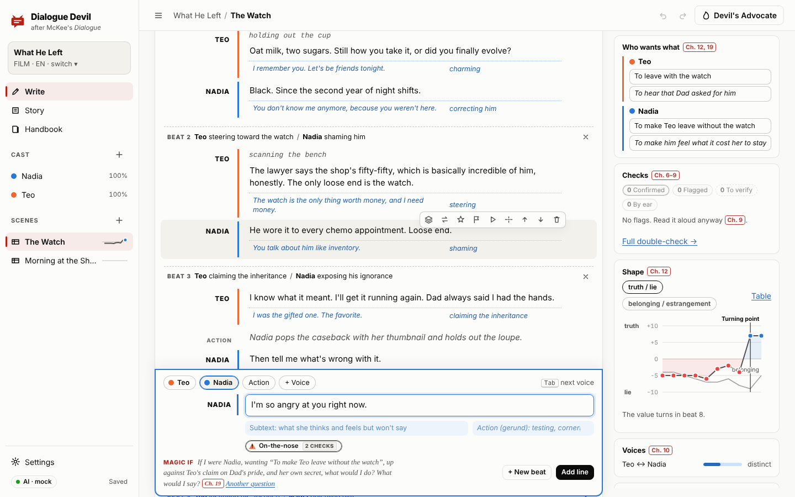
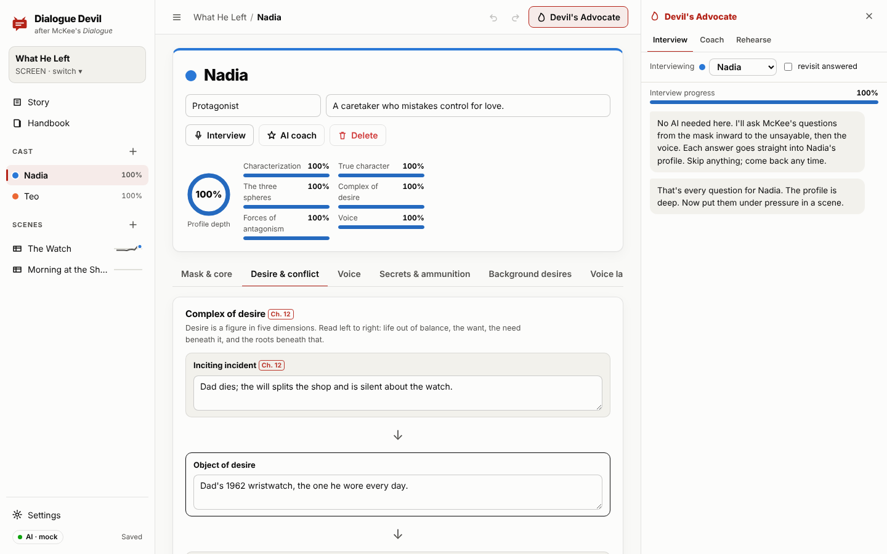
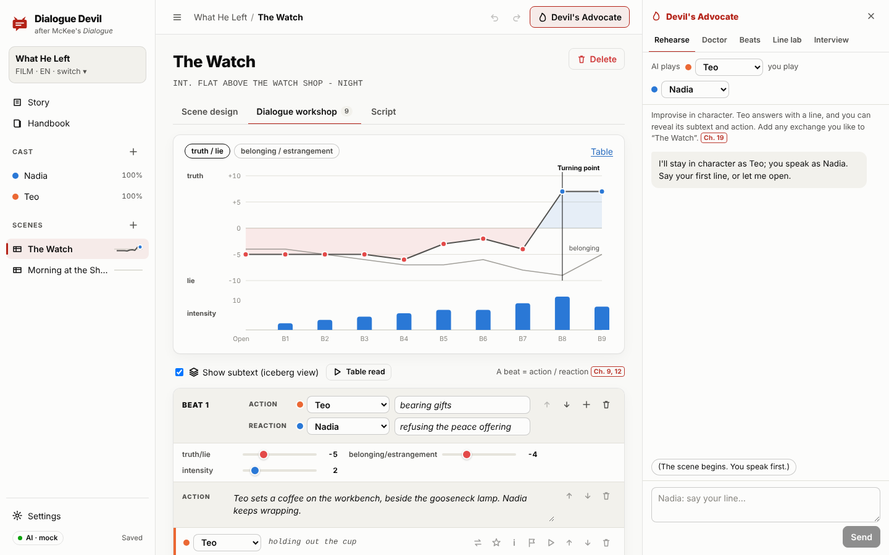
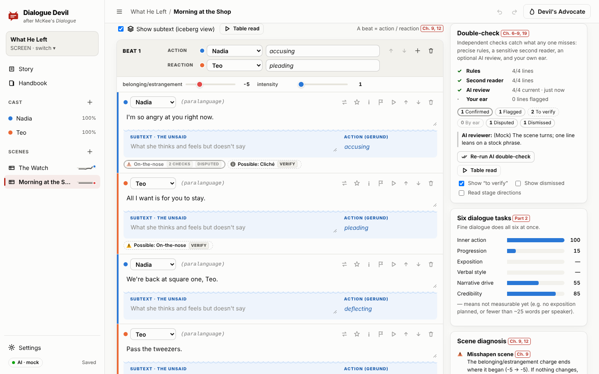
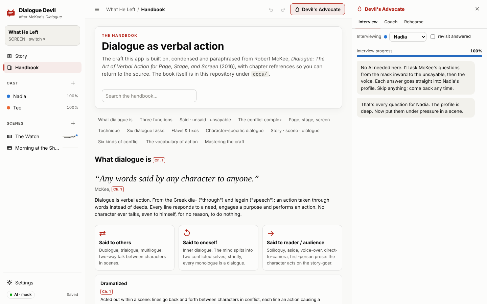
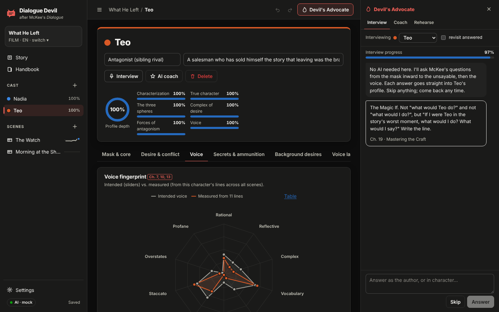
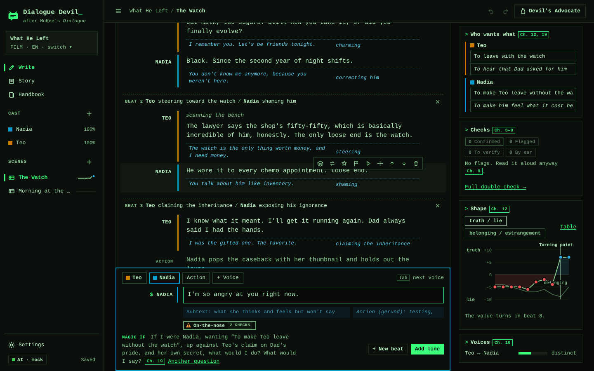

# Dialogue Devil

*Leggi in italiano: [README.it.md](README.it.md). The whole app also works in Italian; see [Italian version](#italian-version).*

An interactive, visual workbench for building fictional characters and developing their dialogue, grounded in Robert McKee's *Dialogue: The Art of Verbal Action for Page, Stage, and Screen* (2016). The book is in [`docs/`](docs/).

McKee's starting point is that dialogue is verbal action. Every line is a tactic a character uses to get what she wants, and the words sit on top of a subtext of desire, antagonism and choice. Dialogue Devil makes that method something you can work through hands-on. You build characters from the inside out and design scenes beat by beat. Each line is written over its subtext, and the scene is checked against the book's flaws and fixes while you write. An optional Claude-powered "Devil's Advocate" can interview you, improvise in character, and propose revisions.

The main panel is the **writing desk**, a place to sketch dialogue quickly for one voice or many. It reads like a script page and takes lines as fast as you type them. McKee's tools wait in the margin, under the line and in a side panel instead of sitting on every line.



## Quick start

Requires Node.js 20 or newer.

```bash
npm install
npm start
```

Open **http://localhost:4134**: it opens on the writing desk. The first run creates an original sample project, *What He Left* (*Quello che ha lasciato* when the server runs in Italian), so every view has something to show. The interface follows your browser's language (English or Italian); change it in **Settings → Language**.

The server also listens on your local network. At startup it prints the address to open on a phone, tablet or another computer on the same Wi-Fi:

```
Dialogue Devil is running.
  This computer:  http://localhost:4134
  Your network:   http://192.168.1.23:4134   (phones, tablets, other computers on this Wi-Fi/LAN)
  Only devices on your local network may connect.
  Access code: off. Set DD_ACCESS_CODE=… to require one on other devices.
```

| Variable | Default | Purpose |
|---|---|---|
| `PORT` | `4134` | HTTP port |
| `HOST` | `0.0.0.0` | Bind address. `0.0.0.0` opens it to your network; `127.0.0.1` keeps it to this computer. |
| `DD_ACCESS_CODE` | (unset) | Code other devices must enter once (remembered for 30 days). This computer never needs it. |
| `DD_ALLOW_PUBLIC` | (unset) | `1` lets non-private (internet) addresses connect. Off by default; see below before turning it on. |
| `DD_DATA_DIR` | `./data/projects` | Where projects are saved (one JSON file each) |
| `ANTHROPIC_API_KEY` | (unset) | Enables the AI collaborator for everyone using this server |
| `DD_MODEL` | `claude-opus-5-5` | Default Claude model |
| `DD_AI_PROVIDER` | `anthropic` | AI service a new browser starts with: `anthropic`, `openai`, `openrouter` or `local` |
| `OPENAI_API_KEY`, `OPENAI_MODEL`, `OPENAI_BASE_URL` | (unset) | OpenAI key, default model, and an optional address (a proxy or an OpenAI-compatible gateway) |
| `OPENROUTER_API_KEY`, `OPENROUTER_MODEL`, `OPENROUTER_BASE_URL` | (unset) | The same for OpenRouter |
| `DD_LOCAL_AI_URL`, `DD_LOCAL_AI_MODEL`, `DD_LOCAL_AI_KEY` | `http://localhost:11434/v1` | Local / OpenAI-compatible server: its address (Ollama's by default), default model, optional key |
| `DD_ALLOW_REMOTE_AI_URL` | (unset) | `1` lets any device set a custom local-server address (see below) |
| `DD_AI_MOCK` | (unset) | `1` = canned AI responses for offline UI development and demos |
| `DD_LANG` | from `LANG` | `en` or `it`: language of the console messages and of the first-run sample. The app itself follows each browser. |

## Using it on other devices

1. Start the server on one computer (`npm start`, or `DD_ACCESS_CODE=pick-a-code npm start`).
2. On the other device, open the **Your network** address. **Settings → Other devices** shows the same addresses with copy buttons.
3. If it doesn't load, allow Node.js / port 4134 through that computer's firewall. Both devices must be on the same network. Guest Wi-Fi with client isolation blocks this.

Every device works on the same projects:
- **Live updates.** An idle device picks up changes saved elsewhere within about four seconds.
- **No silent overwrites.** Each save carries the version it was based on. If another device saved first, the server refuses the stale save (HTTP 409) and the app asks what to keep: *Load the latest*, *Save mine as a copy*, or *Keep mine* (after a confirmation).
- **Nothing lost on close or disconnect.** Edits are copied to the browser as you type and flushed when the tab is hidden or closed. If the server can't be reached, they're kept locally and restored the next time you open the project.

Security defaults:
- Only devices on your local network can connect. That means private addresses (10.x, 172.16–31.x, 192.168.x, and VPN ranges such as Tailscale's 100.64/10), plus devices on this computer's own subnet, for networks that use public addresses internally. The check uses the connection's real address; `X-Forwarded-For` is ignored.
- Without `DD_ACCESS_CODE`, anyone on your network can open your projects, and can use the server's `ANTHROPIC_API_KEY` if one is set. On shared networks, set an access code. The server prints a reminder when a key is set without one.
- An API key typed into Settings stays in that one browser. Each device that should use AI needs its own key, or set the service's key (`ANTHROPIC_API_KEY`, `OPENAI_API_KEY`, `OPENROUTER_API_KEY`) on the server.
- A custom **local AI server address** makes the server fetch that address, so it is accepted from this computer, or from other devices once an access code is set. Otherwise other devices use the server's `DD_LOCAL_AI_URL`. `DD_ALLOW_REMOTE_AI_URL=1` lifts the rule.
- `DD_ALLOW_PUBLIC=1` exposes the app to anyone who can reach the port. Traffic is plain HTTP. If you need access from outside your network, use a VPN such as Tailscale instead, or put the app behind an HTTPS reverse proxy *and* set an access code.

## Italian version

Dialogue Devil works entirely in Italian: interface, handbook, analysis rules, sample project, AI collaborator, exports, server messages and console.

- **Two language settings** in *Settings → Language*:
  - the **interface language**: menus, handbook, analyzer messages and AI replies. It's saved per browser, and the first visit follows the browser's language;
  - the **dialogue language** of the project, saved with the project. It decides which analysis rules read the lines, which voices the table read uses, the language of exports, and the language the AI writes dialogue in.
  
  The two are independent: an English interface over an Italian script works, and so does the reverse. A new project starts in the interface language.
- **Italian knowledge base** (`public/js/kb/it.js`): every principle, flaw, interview question, exercise and tactic, with the same ids and chapter references (`Cap. n`) as the English one. Quotations are free translations of the English text, not the published Italian edition.
- **Italian analysis rules** (`public/js/lang/it.js`): the same checks, rewritten for Italian rather than translated.
  - Tactics are Italian gerunds (*-ando/-endo*, clitics allowed: *mettendola alla prova*).
  - Nearly all Italian is Latinate, so the "arid Latinate" check becomes **abstract, bureaucratic Italian** (*burocratese*: *problematica*, *procedere*, long *-zione/-mento* nouns).
  - Tokenization splits elisions (*l'ho*, *dell'eredità*). Syllables are counted by vowel groups with hiatus. The passive is *essere/venire/andare* + participle.
  - Italian lexicons for clichés (*al punto di partenza*, *prendere il toro per le corna*…), on-the-nose and forced-exposition patterns (*Come sai…*, *Ti ricordi quando…*), emotions, fillers and modality. Voice norms are calibrated for Italian.
  - The second reader stems Italian verbs and strips clitics (*spiegarti*, *spiegando*, *spiegato* → *spieg*).
- **Italian sample**, *Quello che ha lasciato*: the same characters, scenes and beats, written in Italian rather than translated word for word. It gets the same analysis results as the English one.
- **AI in Italian**: Claude receives the Italian framework, replies in the interface language, and writes dialogue, subtext and gerund tactics in the project's language.
- **Exports**: the prose draft uses «caporali» and *disse/chiese*; the annotated breakdown uses AZIONE/REAZIONE; Fountain keeps its required keywords (`Title:`).
- **Table read** uses an Italian system voice for Italian dialogue (or paces silently if there is none).
- **Server**: API errors come back in the interface language, and `DD_LANG=it` (or an Italian `LANG`) sets the console and the first-run sample.

Recall of the Italian double-check, measured on `test/fixtures/flawed-lines.it.js` (original lines written for this purpose):

| Set | Rules alone | Rules + second reader |
|---|---|---|
| Tuning set, 43 flawed lines | 56% | 100% |
| First held-out set, 24 lines, measured once before any fix | 38% | 75% |
| Second held-out set, 20 lines written after tuning and never tuned on | 60% | 80% |
| Clean lines falsely flagged | 0 / 12 | 0 / 12 |

The first held-out set was then used to fix general gaps, so it no longer counts as independent (it now scores 100%). The second set is the honest figure. On unseen lines the Italian checks miss about one planted flaw in five, more than the English ones, so the AI review and the table read matter more in Italian.

`test/i18n.test.js` scans the source for every string the app can show and fails if the Italian dictionary lacks one. It also checks that the Italian knowledge base mirrors the English one entry for entry.

To add another language, add a dictionary (`public/js/locales/`), a knowledge base (`public/js/kb/`), an analysis pack (`public/js/lang/`), and an entry in `LANGS` (`public/js/i18n.js`).


## What's inside

Every principle in the app is paraphrased from the book and tagged with the chapter it comes from (the red `Ch. n` badges; hover for the chapter title).

### Writing desk (the main panel)
Where dialogue gets sketched, for one voice or many. Each dialogue is a scene, so everything written here also feeds the scene design, the beat workshop, the checks and the exports.

- **A script page.** Each line shows who speaks, any parenthetical, and the words. Click any line to edit it in place. Its tools appear only on the line you're on: subtext, alternatives, AI line lab, flag, read from here, new beat here, move, delete.
- **A composer docked at the foot of the page.** Pick a speaker chip, type, press <kbd>Enter</kbd>. The turn passes to the next voice on its own: in a duologue the other one, in a group whoever spoke before.
- **Who's in it.** A new dialogue starts with an empty cast. Pick characters from the project, or type a new name and it becomes a character. **Talking to:** sets McKee's three tracks (to others, to oneself, to the audience), so a single voice can be inner dialogue or a soliloquy (Ch. 1).
- **Quick syntax** in the composer:

  | Type | You get |
  |---|---|
  | `NAME: line` | the line, spoken by NAME; a new name in capitals creates the character |
  | `(softly) line` | paralanguage, in its own place |
  | `[She leaves.]` | an action: stage direction, gesture, silence |
  | `---` | a beat break |

- **Paste a whole scene** (a `NAME: line` transcript, or a screenplay in Fountain style) and it comes in line by line, with new characters created once.
- **Beats as breaks.** A thin rule between beats names its action and reaction (filled from the lines' tactics). Open it to set the main value's charge and the intensity, or remove the break.
- **Checks in the margin.** A small marker shows how many notes a line has; open it for the findings from the double-check. *Quiet drafting* (untick **Checks in the margin**) hides them while you sketch. The draft in the composer is checked as you type.
- **Subtext on demand.** With **Subtext** on, each line's subtext and action (gerund) sit just under it. Empty ones appear only on the line you're editing.
- **The McKee lens** (side panel): what each voice wants right now and really wants; the checks, with a jump to each flagged line; the value arc and its turning point; how distinct the voices are; and the Devil's Advocate modes (rehearse, suggest beats, diagnose) plus *copy as screenplay*.
- A rotating prompt under the composer asks the Magic If and the five steps for the current speaker (Ch. 12, 19).

- **Smart punctuation** as you write: `--` becomes an em dash (a line cut off) and `...` an ellipsis (a line trailing away). It can be turned off in Settings.
- **Focus mode** (<kbd>z</kbd>, or **Focus** in the toolbar) hides the sidebar and the lens, leaving only the page and the writing box.

#### Keyboard shortcuts
Press <kbd>?</kbd> anywhere, or <kbd>Ctrl</kbd>+<kbd>/</kbd> even inside a text box, to see them all. On a Mac, <kbd>⌘</kbd> replaces <kbd>Ctrl</kbd>. Single-letter keys work outside text boxes. Inside them the app avoids Alt+letter, which browsers use for their menus. On Linux, some browsers switch tabs with Alt+1…9; there, use <kbd>Tab</kbd> or the voice chips.

| Keys | In the writing box | On a line of the script |
|---|---|---|
| <kbd>Enter</kbd> | add the line; the turn passes to the next voice | new line after it, for the next voice |
| <kbd>Alt</kbd>+<kbd>Enter</kbd> | add the line; the same voice goes on | new line after it, for the same voice |
| <kbd>Ctrl</kbd>+<kbd>Enter</kbd> | add the line as the start of a new beat | start a new beat at this line |
| <kbd>Shift</kbd>+<kbd>Enter</kbd> | new line inside the speech | new line inside the speech |
| <kbd>Tab</kbd> | empty box: next voice; with words typed: go under the line (subtext, then action) | go under the line |
| <kbd>Shift</kbd>+<kbd>Tab</kbd> | previous voice | |
| <kbd>Alt</kbd>+<kbd>1</kbd>…<kbd>9</kbd> | pick a voice | give the line to that voice |
| <kbd>Alt</kbd>+<kbd>0</kbd> | write an action | turn the line into an action, or back |
| <kbd>↑</kbd> / <kbd>↓</kbd> | <kbd>↑</kbd> from the start: edit the last line | at the start / end: go to the line above / below |
| <kbd>Alt</kbd>+<kbd>↑</kbd> / <kbd>↓</kbd> | | move the line (across beat breaks too) |
| <kbd>Backspace</kbd> | | on an empty line: delete it |
| <kbd>Esc</kbd> | leave the box (then <kbd>Tab</kbd> moves on) | leave the line |

| Outside a text box | |
|---|---|
| <kbd>?</kbd> | the keyboard shortcuts |
| <kbd>/</kbd> | jump to the writing box |
| <kbd>n</kbd> | new dialogue |
| <kbd>[</kbd> / <kbd>]</kbd> | previous / next dialogue |
| <kbd>g</kbd> then <kbd>w</kbd> / <kbd>s</kbd> / <kbd>h</kbd> / <kbd>,</kbd> | go to Write / Story / Handbook / Settings |
| <kbd>s</kbd> · <kbd>q</kbd> · <kbd>l</kbd> | show or hide the subtext · the checks in the margin · the McKee lens |
| <kbd>z</kbd> | focus mode |
| <kbd>a</kbd> | open or close the Devil's Advocate |
| <kbd>r</kbd> | read the scene aloud, or stop (during the read, <kbd>F</kbd> flags the line, <kbd>Esc</kbd> stops) |
| <kbd>Ctrl</kbd>+<kbd>Z</kbd> / <kbd>Ctrl</kbd>+<kbd>Shift</kbd>+<kbd>Z</kbd> | undo / redo |

The full apparatus is one click away: **Scene design**, **Beat workshop** and **Script**.

### Help guide
**Help** in the sidebar (`#/help`) explains how to work in the app:
- a six-step start;
- the quick syntax and every shortcut;
- a map of where everything is;
- McKee's method at a glance, from the same knowledge base as the Handbook;
- answers to common questions (saving, undo, AI, Italian, other devices, a check that is wrong).

The shortcuts overlay and the guide are built from one list (`public/js/shortcuts.js`), so they always match the app.

### Story dashboard
Medium (stage/screen/TV/prose) and vision (realism or nonrealism, which changes how strictly on-the-nose dialogue is judged, Ch. 8). Also the core value, inciting incident and major dramatic question. Infographics:
- **Cast cards** with mini voice fingerprints and profile depth.
- **Voice line-up**: overlays up to three characters' voices and measures how far apart they are (Ch. 10).
- **Conflict complex heat map**: characters × physical/social/personal/inner antagonism, with a "complex vs. complicated" verdict (Ch. 4, 12).
- **Scene table** with value-arc sparklines, turning points and six-task health.

### Character Studio (all the character elements in the book)
| Tab | Elements | Source |
|---|---|---|
| Mask & core | Interactive **three spheres** (said / unsaid / unsayable). Characterization (biology, upbringing, education, mentality, values) vs. true character, the core contradiction, dramatic vs. comic mentality and the comic "humor" | Preface, Ch. 2, 3, 14 |
| Desire & conflict | **Complex of desire** map: inciting incident → object of desire → spine of action, super-intention vs. subconscious desire, motivation vs. excuse. **Forces of antagonism** as four concentric rings | Ch. 6, 12, 4 |
| Voice | **Voice fingerprint radar**, intended (sliders) vs. measured from the character's actual lines across all scenes. Ten voice dimensions plus context level; lexicon (knowledge nouns/verbs, modifiers, signature words, never-says, cultural treasure chest); modality; natural line design; dialect and paralanguage | Ch. 5, 7, 10, 12, 13 |
| Secrets & ammunition | Secrets with their lesser-of-two-evils dilemma and the scene where they're revealed. Exposition facts ranked by importance that can be sent into a scene as ammunition | Ch. 2 |
| Background desires | **Web of restraint**: relationships with a diverging charge, and what the character can't say yet | Ch. 12 |
| Voice lab | "Say it their way" exercises (shock without "Oh my God", love unsaid, state vs. understate, sensory trope, the specific verb, the third thing, the Magic If…), each analysed live. A "test any line" box | Ch. 2, 5–8, 10, 15, 19 |



### Scene design
Track (to others / to self / to audience) and mode (dramatized/narratized). One of six **conflict types** from the case studies (balanced, comic, asymmetric, indirect, reflexive, minimal), each with its own craft tips. **Who wants what**: conscious and subconscious scene intentions, opening tactics, sense of antagonism, and the scene driver. **Values at stake** with opening charges. **Third thing** diagram (trialogue vs. duelogue). Exposition to smuggle, the turning-point plan, and the Ch. 19 **key questions** checklist.

### Beat workshop (the full apparatus)
The same scene as on the writing desk, with every tool laid out at once.



- **Value arc**: charge per beat for each value at stake, with the turning point found automatically and beat intensity bars beneath. Hover for the crosshair readout, or switch to a table view.
- **Beats** named as action/reaction gerunds (e.g. *Teo bearing gifts / Nadia refusing the peace offering*), each with its own charges and intensity.
- **Lines in iceberg view**: the said above the waterline, the unsaid and the action (gerund) below it. Paralanguage, stage directions and silence are first-class.
- **Composer built on the five steps of behavior**: desire → sense of antagonism → choice of action → action → expression, with a live **Magic If** prompt. Line tactics fill in the beat's action/reaction automatically.
- **Alternatives scratchpad** on every line, after Ch. 7's "never settle for the first choice": swap versions in and out.
- **Live analysis** of every line and of the whole scene:
  - On-the-nose, empty talk and forced exposition.
  - Over-emotive and overly perceptive talk, and melodrama (emotion out of proportion to the beat's stakes).
  - Clichés and character-neutral phrases; clutter; arid Latinate language; passive voice; long speeches and the monologue fallacy.
  - Blurred meaning, mistimed cues, accidental echoes, and words the character "never says".
  - At scene level: repetitious beats, nonevents and mistimed turning points, duelogues, characters who sound alike, and voice drift from the profile.
- **Double-check** (below): independent checks that catch what a single pass misses.
- **Table read**: the browser reads the scene aloud line by line, and you press <kbd>F</kbd> to flag a line that sounds wrong. The case studies advise reading scenes aloud, or better, acting them out (Ch. 13, 15). Where speech synthesis isn't available, it paces silently at reading speed.
- **Six dialogue tasks scorecard**, plus a Sopranos-style **content · length · pace** table per speaker (Ch. 13).
- **Script** export: Fountain screenplay, stage play, prose draft, or an annotated beat breakdown with subtext.

### Double-check: limiting missed problems
A single set of rules is precise but misses a lot. On the bundled test lines, the rules alone catch 40% of the planted flaws. So every line goes through independent checks, and the results are merged:

| Layer | What it does | Needs |
|---|---|---|
| **Rules** | Precise patterns: on-the-nose statements, clichés, clutter, Latinate diction, long speeches… | nothing |
| **Second reader** | A recall-oriented pass. It uses stemming, fuzzy phrase matching that tolerates filler words, and lexicons for emotion, exposition and abstraction. At scene level it also looks for repeated tactics and missing reactions. | nothing |
| **AI review** | Claude reads the scene with the profiles and the analyzer's findings. It reports what the other checks missed and disputes their false alarms. | API key |
| **Your ear** | Lines you flag during a table read | nothing |

Each finding shows its sources and a status:
- **Confirmed**: two or more checks agree.
- **Flagged**: the rules alone.
- **Verify**: one sensitive check alone, so look before acting.
- **By ear**: you flagged it.

The AI can mark a finding *disputed* with its reason. You can **dismiss** a finding as deliberate; it's remembered per line and can be shown again. AI results are fingerprinted per line: edit a line and its AI findings are marked stale until the next review. The double-check card shows each layer's coverage, and the story table counts lines still to verify.

Measured on `test/fixtures/flawed-lines.js` (lines written for this purpose, so treat the numbers as optimistic):

| Set | Rules alone | Rules + second reader |
|---|---|---|
| Tuning set, 42 flawed lines | 40% | 100% |
| Held-out set, 24 flawed lines written after tuning | 38% | 100% |
| Clean lines falsely flagged | 0 / 12 | 0 / 12 |

The reliable signal is the gap, not the 100%: real scenes will have misses that no heuristic sees. That's why the AI review and the table read exist. "Verify" findings are not errors; they're cues to look again.



### Handbook
A searchable, infographic condensation of the book's framework. It covers:
- the definition, three tracks and three functions;
- the spheres, the conflict complex, and how dialogue works across media;
- line design and technique, and the six tasks;
- every flaw with its fix;
- character-specific dialogue, and story/scene design (complex of desire, five steps, beats, turning points);
- the six conflict types, a tactics vocabulary, and the key questions and axioms.



### The Devil's Advocate (right-hand panel)
- **Interview** (no AI needed): a dialogic interviewer that asks McKee's questions from the mask inward to the unsayable, then the voice. Each answer goes straight into the profile.
- **AI modes** (optional): each needs an API key.
  - **Coach**: interviews you about a character and proposes profile updates as cards you apply or dismiss.
  - **Rehearse**: the AI improvises *in character*, using the voice profile and scene intention, while you play the other role. Every reply carries its hidden subtext and action, and you can add any exchange to the scene.
  - **Doctor**: diagnoses the scene from the analyzer's findings, root causes first, and proposes rewrites.
  - **Beats**: proposes the next beats, each topping the last.
  - **Line lab**: five alternatives for a line, each a different tactic.
  - **Review**: the AI layer of the double-check (run it from the workshop's double-check card).

The AI never edits your work directly. It calls proposal tools, and you choose what to apply. Every AI-applied change can be undone.



### Themes
In **Settings → Appearance → Theme**, *System* follows the device (light or dark), or you can pick *Light*, *Dark* or *Terminal*.

**Terminal** is a minimal theme in green-phosphor style: one monospace typeface, green on black, square corners, no shadows, and inverse-video buttons and selection. Its eight character colors and chart palettes were checked against the terminal background for lightness, colorblind separation and contrast, so speakers and charts stay easy to tell apart. All text clears 4.5:1 contrast.



## AI setup (optional)

In **Settings → AI collaborator**, pick a **service**:

| Service | What you need | Model |
|---|---|---|
| **Anthropic (Claude)**, the default | an Anthropic API key | chosen from the list; Claude Opus 5.5 by default |
| **OpenAI** | an OpenAI API key | typed in, or picked from **Load models** |
| **OpenRouter** | an OpenRouter key | `provider/model`, typed in or picked from the list |
| **Local / compatible** | a server with an OpenAI-compatible API: Ollama, LM Studio, llama.cpp, vLLM, or any other. A key only if the server asks for one. | picked from the models the server has loaded |

Paste the key into Settings, or set it on the server (`ANTHROPIC_API_KEY`, `OPENAI_API_KEY`, `OPENROUTER_API_KEY`). A key entered in Settings stays in that browser's local storage. It is sent to your own Dialogue Devil server with each AI request, which uses it for that request only and never writes it to disk. Each service keeps its own key and model, so switching back and forth loses nothing. **Test connection** lists the service's models, which checks the key and the address without spending tokens.

**Local models.** Start the local server (for example `ollama serve` with a model pulled, or LM Studio's local server). Choose its preset (Ollama `:11434`, LM Studio `:1234`, llama.cpp `:8080`, vLLM `:8000`) or type its address, then load the models and pick one. "localhost" means the computer running Dialogue Devil, even when you are on a phone. Two things matter:
- **Tool calling.** The coach's proposals, the beats, the line lab and the AI double-check arrive as tool calls. A model without tool calling can still talk, and the app says so, but it can't make proposals.
- **Context length.** The McKee framework alone is about 6k tokens, so give the model at least 16k. Ollama and LM Studio often start with less, and a shorter window cuts the framework off. For local servers the project context sent with each request is also capped at about 6k tokens.

The prompts were written and tested with Claude; other models may follow the method less closely.

Under the hood, `server/ai.js` uses the official `@anthropic-ai/sdk` for Claude:
- A streaming tool-use loop over the Messages API, with text streamed to the browser over server-sent events.
- Proposal tools validated with zod before they reach the UI.
- Eager input streaming on tools.
- A prompt-cached system block generated from the same knowledge base the UI uses (`public/js/kb/`), in the writer's language.
- Server-side refusal fallback (`fallbacks: "default"`) on models that support it.

The default model is Claude Opus 5.5; Settings offers Sonnet 5.5, Haiku 5.5 and Fable 5.1.

The other services go through `server/providers.js`. It calls the Chat Completions HTTP API directly, the format all of them share, with no extra SDK. It runs the same loop: text streamed to the browser, the same proposal tools sent as functions and validated with the same schemas, tool results sent back. Review and rehearsal force their tool (`tool_choice`). If a model refuses tools, the loop steps down and carries on without them. Errors name the cause: a rejected key, an unknown model or address, an unreachable server, a context window that is too small.

## Project layout

```
server.js               Express app: static UI, project REST API, AI SSE endpoint (port 4134)
server/ai.js            Claude agent loop, provider dispatch, error mapping, mock mode
server/providers.js     OpenAI, OpenRouter and local/OpenAI-compatible services: tool loop, model lists, address rule
server/tools.js         Proposal tool schemas, shared by every service
server/prompts.js       System prompt (built from the knowledge base) and tool definitions
server/storage.js       JSON file storage, one file per project, with revisions and per-project save locks
server/network.js       LAN guard (private addresses only), optional access code, network addresses
server/lang.js          Language of each request (x-dd-lang, Accept-Language) and of the console (DD_LANG, LANG)
public/index.html       Single-page app shell (Preact + htm, no build step)
public/css/app.css      Design tokens (light/dark), layout, components
public/js/kb/en.js, it.js  The knowledge base in each language: principles, schema, interview, tactics, flaws, all with chapter refs
public/js/mckee.js      Serves the knowledge base in the interface language
public/js/i18n.js       Interface language: tr()/trl()/trn(), date formats, language detection
public/js/locales/it.js Italian dictionary (English source string → Italian)
public/js/lang/en.js, it.js  Per-language analysis packs: tokenizer, syllables, lexicons, patterns, norms, stemmer
public/js/analysis.js   Dialogue analysis engine: the rules layer (pure functions, shared with tests)
public/js/secondreader.js  Second reader: the recall-oriented layer
public/js/doublecheck.js   Merges rules, second reader, AI review and the writer's flags into statuses
public/js/review.js     Runs the AI review and stores it with per-line fingerprints
public/js/store.js      State, autosave with revisions, conflict handling, local backups, live updates
public/js/model.js      Data model and factories
public/js/sample.js     Original sample project ("What He Left")
public/js/sample.it.js  Its Italian counterpart ("Quello che ha lasciato")
public/js/export.js     Fountain / stage / prose / annotated exporters
public/js/sketch.js     Writing-desk helpers: quick-entry syntax, pasted scripts, line and beat moves
public/js/components/   Shared UI and SVG infographics (value arc, radar, spheres, rings, web…)
public/js/views/        Writing desk (write.js), story, character, scene design, workshop, handbook, settings, assistant drawer
test/                   node:test suites (analysis in both languages, double-check, translation completeness, REST API and conflicts, LAN guard, AI loops against a fake Anthropic endpoint)
```

## Tests

```bash
npm test
```

The suites cover:
- the analysis heuristics (one test per major flaw family), voice measurement, turning-point detection, the exporters and the sample project;
- the writing desk's helpers: the quick-entry syntax, pasted transcripts and screenplays (the Fountain export of both samples round-trips), who speaks next, and moving lines and beat breaks;
- the double-check: recall on the tuning and held-out sets, no false alarms on clean lines, statuses, disputes, dismissals and stale AI findings;
- the Italian version: every displayed string translated with its placeholders, the knowledge bases matching entry for entry, the Italian rules (elisions, passive, *burocratese*, gerunds, stemming), Italian recall and false alarms, the Italian sample and exports;
- the REST API, including revision conflicts and concurrent saves;
- the themes: the terminal and dark themes define every color token, so nothing falls back to light values;
- the LAN guard and access code;
- the AI tool-use loop, including the review report and the Italian framework and language instructions. The loop runs offline against a local fake of the Messages API streaming endpoint;
- the other AI services, against a fake Chat Completions server. The tests cover streamed text and tool calls split across chunks, the follow-up turn, the forced review tool, a model without tools, a server that answers with plain JSON, bearer keys and the model list, readable errors, and the rule for custom addresses.

## About the source

Principles are paraphrased and cited by chapter; quotations from the book are kept to a few short lines. In the Italian version they are free translations. The sample scene and characters are original, written to demonstrate the method: a third thing (the watch), exposition used as ammunition, and a backstory revelation as the turning point.
